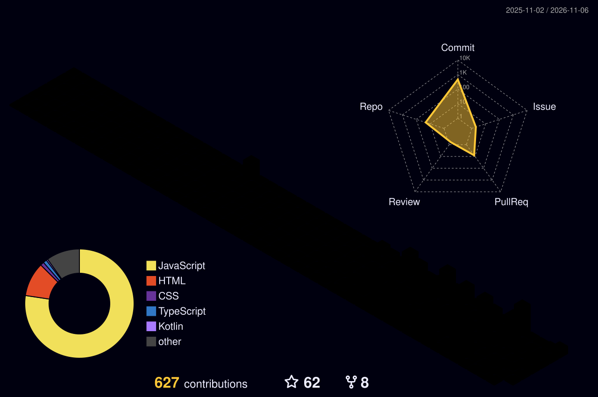

  

# 💫 About Me

🎓 MCA Student 
💻 Full Stack Developer 
🚀 Passionate about building scalable web applications 
📱 Building cross-platform apps with Capacitor and offline-first websites 
📋 Experienced with Jira for Agile Project Management and Issue Tracking

## 💗 Tech Stack

<table width="100%" border="1" cellpadding="6" cellspacing="0">
<tr>
<td width="25%" align="center" valign="top">
<h5>🛠️ Tools</h5>

</td>
<td width="25%" align="center" valign="top">
<h5>🌐 Frontend</h5>
 

</td>
<td width="25%" align="center" valign="top">
<h5>⚙️ Backend &amp; Database</h5>

</td>
<td width="25%" align="center" valign="top">
<h5>💻 Languages</h5>

</td>
</tr>
</table>

---

## ☁️ Deployment & DevOps

---

## 🤖 AI Tools & Assistants

---

## 📜 Certifications

- Web Development Mentorship Course – Launched Global (IIT Kharagpur)
- MERN Stack Summer Trainee – SRDT Pvt. Ltd
- LibreOffice Calc & RDBMS PostgreSQL – **IIT Bombay**
- Cyber Security Course – Lucknow Public College of Professional Studies

## 🏆 Activities

- Workshops & Seminars
- Hackathons as Team Leader
- Short-Term Courses
- Academic & Personal Projects
- Communication Skills

## 🌟 GitHub Stats

---

<!--
## 📈 Activity Graph

---
-->

<h2 align="center">🏆 GitHub Trophies</h2>

  

---

## 🏆 3D Contribution Graph

## 🌐 Connect

---

<!--
## 📊 GitHub Summary

<table>
<tr>
<td align="center">

</td>
<td align="center">

</td>
</tr>

<tr>
<td align="center">

</td>
<td align="center">

</td>
</tr>
</table>

-->

## 💭 Dev Quote

  

